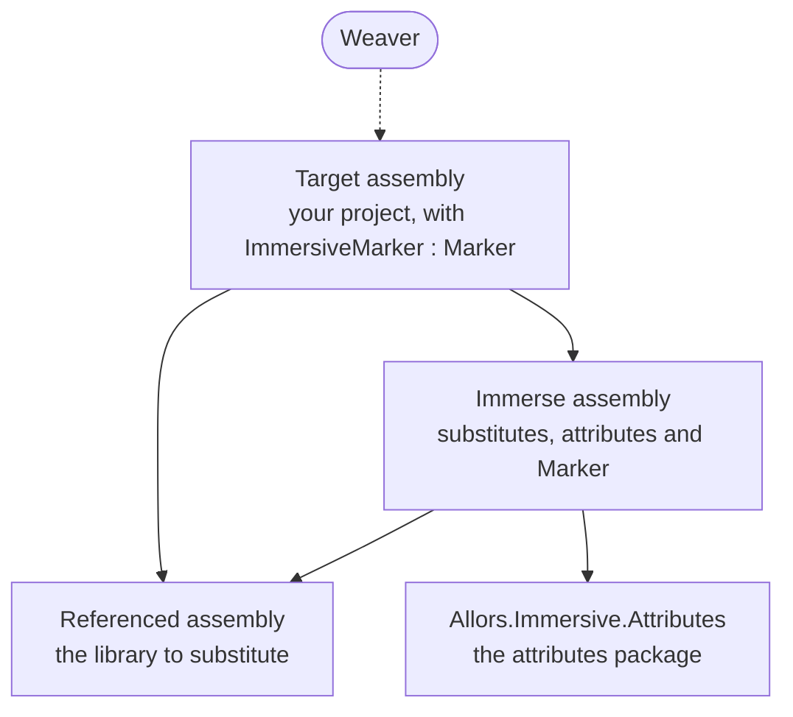

> **Status: Current.** Explanation for users. It describes the weaving engine in
> `src/Allors.Immersive` as checked by the tests named at the end.

Immersive rewrites an assembly after it has been compiled. The source code keeps using the
library it was written against; the compiled assembly uses substitutes instead. This page
explains the pieces involved and the exact rewrites the weaver makes, so that you can predict
what a woven assembly does.

## Three assemblies and a marker

Each solid arrow points from an assembly to one it references; the dotted arrow shows the
weaver rewriting the target.

- The **referenced assembly** is the library whose classes and methods are to be replaced. It
  is not changed and needs no knowledge of Immersive.
- The **immerse assembly** declares the substitutes and marks them with the attributes from the
  `Allors.Immersive.Attributes` package. It references the referenced assembly, because a
  substitute class usually derives from the class it replaces and the attributes name classes
  with `typeof`.
- The **target assembly** is the one the weaver rewrites: a project that references both. It
  identifies the immerse assembly with a **marker**: a top-level class named `ImmersiveMarker`
  whose base type is declared in the immerse assembly. The marker's namespace and the name of
  its base type do not matter; only the class name and the assembly of the base type do.

The weaver loads the target assembly, finds the marker, resolves the immerse assembly by the
name of the assembly that declares the marker's base type, collects the substitutes, rewrites
every class in the target and saves the assembly in place. Without a marker it reports
`No immersive assembly found` and leaves the file untouched, which is how a Release build stays
unwoven when the marker is declared under `#if DEBUG`.

## Substitute classes

`[SubstituteClass]` marks a class in the immerse assembly as the replacement for a class of the
referenced assembly, the **substitutable class**. There are two forms.

**Base substitution** is `[SubstituteClass]` without an argument. The substitute derives from
the substitutable class, and that base class is what it substitutes. The weaver requires a base
type in this form and fails with `Base type is required for <type>` otherwise. Because the
substitute is a subclass, every field, variable and parameter of the substitutable type can
hold an instance of it, so the weaver changes only where instances are created and what the
target's classes derive from. The Windows Forms and Avalonia libraries use this form for every
control; the tutorial's `Dialog` is an example.

**Explicit substitution** is `[SubstituteClass(typeof(Referenced.Type))]`. The substitute names
the class it replaces and need not derive from it, which is the only option for a sealed class.
The substitute must then declare the members the target uses, with the same names and
signatures, because the weaver retargets the target's references to those members; a member
the substitute lacks fails at run time. The repository's test fixture substitutes the sealed
classes `SealedSingle` and `SealedHierarchy` this way, and the Windows Forms library uses it
for the common dialogs, five of which are sealed.

The weaver matches substitutable classes by their full name; a generic instantiation of a class
does not match the class. A substitute class can declare several constructors, but the weaver
always uses the first constructor declared in the class and does not compare its parameters
with those of the constructor the target called. Give a substitute one constructor with the
parameters the target uses; the libraries in this repository give each substitute a single
parameterless constructor.

## Substitute methods

`[SubstituteMethod(typeof(Referenced.Type))]` and
`[SubstituteMethod(typeof(Referenced.Type), "Name")]` mark a method as the replacement for a
method of the referenced assembly. The first form uses the attributed method's own name; the
second names the substituted method, so the substitute can have a different name. A call in the
target matches a substitute method when the called method's declaring type, its name and the
full names of its parameter types are equal, in order. The return type is not compared. Each
overload needs its own attributed method; the Windows Forms `MessageBox` substitute declares
one `Show` per overload it covers.

A static substitute method can live in any class of the immerse assembly: the call is simply
redirected. An instance substitute method must be declared on the base substitute of the same
class, because the call keeps its receiver: after the weave the target's instance is an instance
of the substitute, so the call is valid. The tutorial's `ShowDialogSubstitute` on the substitute
`Dialog` follows this pattern.

A substitute method can still call the original. The test fixture's `AllorsShowDialog` returns
`"Substitute: " + ShowDialog()`, calling the inherited method.

## What the weaver rewrites

The weaver visits every class of the target assembly, nested and compiler-generated classes
included, but not interfaces. For each class it makes these passes, in this order.

| Pass | Base substitution | Explicit substitution |
| --- | --- | --- |
| Constructor calls | A `call` to the substitutable class's constructor inside a constructor of the class, which is how a derived class calls its base constructor, and every `newobj` of the substitutable class, now use the substitute's first constructor. | The same. |
| Base type | A class that derives from the substitutable class now derives from the substitute. | The same. |
| Method calls | A `call` or `callvirt` whose method matches a substitute method now calls the substitute method. | The same; in addition, every other call to a member of the substitutable class is retargeted to the member with the same name and signature on the substitute. |
| Field types | Unchanged. | A field declared with the substitutable type now has the substitute type. |
| Local variables | Unchanged. | A local declared with the substitutable type now has the substitute type. |
| Return types | Unchanged. | A method returning the substitutable type now returns the substitute type. |

The weaver leaves parameter types, property and event signatures, generic arguments, custom
attributes and strings unchanged, and does not inspect `calli` instructions. After a base
substitution the declared type of a field still names the referenced class while the object
stored in it is a substitute: the test `ClassTests.Default` checks exactly that for the
fixture's `button1` field, whose type remains `AssemblyReferenced.Button` while its value is an
`AssemblyToImmerse.Button`.

The weaver writes the assembly file only. It does not read or update the symbol file, so the
`.pdb` of a woven assembly no longer describes it; the repository's woven fixture applications
disable symbol generation. Weaving an already woven assembly finds nothing more to substitute
and saves the file again.

## Where the facts live

The engine is checked by `test/Allors.Immersive.Tests`, which weaves the fixture
`Allors.Immersive.AssemblyToProcess` with the substitutes in
`Allors.Immersive.AssemblyToImmerse` and then loads the result:

- `ClassTests.Default`: the base type is replaced; the target's, the substitute's and the
  referenced class's constructors all run; `newobj` creates substitutes; explicit substitution
  changes field types while base substitution does not.
- `MethodTests.SubstituteWithType` and `MethodTests.SubstituteWithTypeAndMethodName`: static
  overloads and an instance method with a different name are redirected, and an overload with
  no substitute is left alone.
- `AssemblyToProcessTests.Default`: the unwoven fixture behaves as written.
- `AssemblyTests.PeVerify`: on .NET Framework in Debug, runs PEVerify on the original and on
  the woven assembly and compares the reports. The test passes the two directories instead of the
  two files, so PEVerify reports `File not found or has bad headers` for both and no IL is
  verified; observed on 2026-10-19. [Weaver internals](internals/weaver.md#tests) has the detail.

[Weaver internals](internals/weaver.md) describes the classes that implement these passes.
